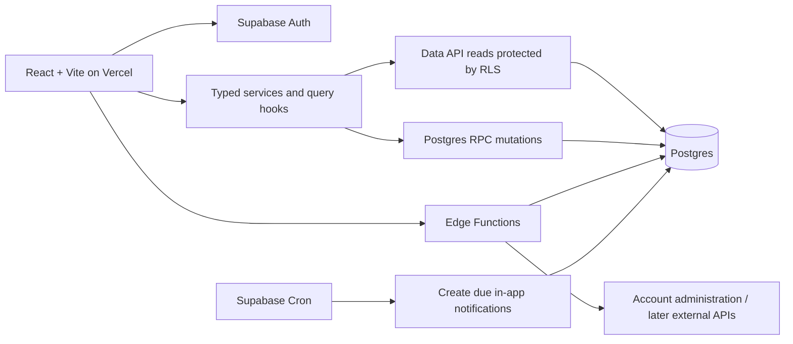

# Fitness app backend implementation plan

> **Implementation update — November 2, 2026:** This repo is a standalone download from Figma Make. The user selected Supabase Postgres/Auth. The actual export uses **Next.js + React + Tailwind**, not Vite. The current implementation and setup instructions in [docs/backend-api.md](docs/backend-api.md), [docs/backend-setup.md](docs/backend-setup.md), and [docs/database-schema.md](docs/database-schema.md) supersede conflicting details below. The October proposal is preserved as future design context; it is not a list of implemented tables/features.

Current MVP: signup/login through Supabase Auth; completed workout logs; derived XP, daily/weekly streaks and levels; simple calendar CRUD; preset characters; level-unlocked cosmetics; editorial news/tutorials. There are 18 Next.js API handlers and seven SQL app tables. No Supabase project has yet been provisioned or connected. Social, reminders, active workout sessions, detailed set tracking, automatic scheduling, battle passes, and currency are deferred.

Prepared October 28, 2026. Status: proposed implementation contract, not an implemented backend.

## 1. Recommendation and how to use this package

Keep React + Vite + Tailwind. Add TypeScript where the generated app does not already use it, and use **Supabase managed Postgres, Auth, database functions, and Cron** for the backend. Use **Supabase Edge Functions** for operations requiring external APIs or administrative credentials. Host the Vite frontend on **Vercel**. Keep frontend integration code, SQL migrations, backend functions, tests, and documentation in the GitHub repository generated by Figma Make.

This is a good fit for a relational app with private workout histories, transactional rewards, and friend relationships. Start with one backend project per environment and one repository. A separate Express/Nest server, Redis, ORM, event bus, or AI recommendation service is unnecessary for the initial scope. Supabase documents a React/Vite integration, and Vercel supports Vite deployments. [Supabase React quickstart](https://supabase.com/docs/guides/getting-started/quickstarts/reactjs), [Vercel Vite guide](https://vercel.com/docs/frameworks/frontend/vite).

Read these files in order:

1. **This plan:** product scope, architecture, behavior, API contracts, and operations.
2. **[Database schema](database-schema.md):** exact proposed entities, fields, relationships, constraints, indexes, and permissions.
3. **[Agent implementation tasks](agent-implementation-tasks.md):** ordered work packages and acceptance criteria; includes a copyable implementation prompt.

The feature list is product input, not authorization to implement every brainstorm. Its first page identifies onboarding, scheduling, gamification, workout tracking, and social features. Its second page explores competition, anti-cheating, monetization, and long-term ideas. This plan prioritizes the recurring workout loop and treats unresolved ideas as later work.

No repository or running app was provided for inspection. Paths below are target conventions: the implementation agent must adapt them to the actual export without replacing its layout or dependency setup. The schema is a specification for migrations, not executable SQL or a claim that security policies have been tested.

## 2. Core scope and product defaults

### Delivery order

| Phase | Deliver | Completion boundary |
|---|---|---|
| **P0: personal workout loop** | Accounts; onboarding; goals, experience, frequency, preferred times; exercise/workout menu; manual scheduling; simple suggestions; in-app reminders; persistent workout logs; XP, level, basic avatar; weekly streak; account deletion | A new user can return on another device and complete the entire loop with real data |
| **P0b: small social beta** | Exact-handle friend discovery, requests/acceptance/removal, blocking, explicitly shared progress summaries | Two consenting friends can see limited progress; strangers and blocked users cannot |
| **P1: integrations and community** | Google Calendar free/busy and event export; email/push reminders; friend streaks; groups; opt-in school competitions | Specify verification, consent, scoring, and delivery behavior before implementation |
| **P2: game expansion** | Character attributes, battles, ELO, PvE bosses, boosts, inventory, outfits/weapons/village; HealthKit/Strava; camera guidance; battle pass/currency/gacha | Separate product and technical designs; do not scaffold these systems during P0 |

### Feature coverage

| Feature-list item | Initial treatment |
|---|---|
| Gym goals, experience, frequency, preferred workout time | P0 onboarding and editable preferences |
| Calendar connection | P1. P0 offers an internal calendar and optional client-generated `.ics` export |
| Recommend times | P0 ranks declared time windows, avoiding this app's scheduled workouts; explicitly cannot see external conflicts |
| Reminders | P0 in-app inbox/due badge; P1 delivery when the app is closed |
| Workout logs and selecting workouts | P0 templates, editable active session, sets/reps/weight or time/distance, history |
| Recommend exercises | P0 deterministic template filtering by goals and experience; no personalized training prescription |
| Exercise guides/images | Basic names and short descriptions or existing licensed images only; richer guides deferred as contemplated on PDF page 2 |
| Character level, XP, character design, streaks | P0 deterministic rewards, level, preset avatar, weekly goal streak |
| Character speed/strength, boosts, special items | P2; do not infer game attributes from self-reported lifting numbers |
| Friends and shared progress | P0b; shared streaks come in P1 |
| School/group leaderboards and accountability | P1; private opt-in groups before school-wide rankings |
| Battles, ELO, group-vs-boss | P2 |
| Location, Apple Health, Strava anti-cheating | P2. P0 is explicitly self-reported, with server-controlled rewards |
| Currency, battle pass, gacha, lore, events/collabs | P2; no payment or economy tables now |

### Explicit assumptions for the implementation agent

These are proposed defaults because the feature list does not settle them. Use them until the team changes the contract; they are not claims about an existing product decision.

- Launch as a responsive web app, initially for individual users. No organization tenancy or school membership in P0.
- Use email/password Auth with email confirmation and password reset. Add Google sign-in later if desired; it is separate from Calendar authorization.
- No anonymous workout accounts. Onboarding resumes after sign-in if incomplete.
- Weekly frequency means **distinct workout days per week**, target 1–7, default 3. Use a weekly streak to allow rest days. The UI should label this clearly.
- A qualifying workout has at least one completed, valid logged set. Award **100 XP per distinct qualifying day**, independent of duration, weight, or number of sessions. This reduces the incentive to inflate volume; it does not prove a workout happened.
- Level = `1 + floor(total_xp / 500)`. XP is progression, not spendable currency. All avatars are a small preset allowlist; cosmetic choice has no gameplay effect.
- Users select a **home timezone** during onboarding. Freeze it for reward/streak accounting in P0; scheduling can use other timezones. A future home-timezone change needs an explicit migration rule so past dates and rewards do not shift.
- Online account-backed logging only. Autosave and reload recovery are required; a full offline synchronization engine and backdated reward-bearing workouts are deferred. Show an unsaved state on network failure.
- Completed workouts are immutable. Users can remove one through a server-side void action; active sessions remain editable. Do not silently edit historical rewards.
- Progress sharing defaults off. P0b friends see only the summary described below, never private sets, notes, precise times, or goals.

## 3. Architecture and ownership



### Stack choices

| Concern | Choice | Reason / boundary |
|---|---|---|
| Frontend | Existing React, Vite, Tailwind; TypeScript | Preserve Figma Make UI and routing |
| Data access | `@supabase/supabase-js`, generated DB types | One typed client; user session attached to requests |
| Server state | TanStack Query if no equivalent exists | Cache, invalidation, loading/error states; clear on sign-out |
| Input validation | Zod at UI/integration boundaries; SQL validation authoritative | Browser validation alone cannot protect data |
| Backend/database | Supabase managed Postgres | Foreign keys, transactions, indexes, RLS |
| Identity | Supabase Auth | Keep passwords and Auth identities out of app tables |
| Business mutations | SQL/PLpgSQL functions invoked with `rpc()` | Atomic session completion, reward updates, and social transitions |
| External/admin actions | TypeScript Supabase Edge Functions | Account deletion first; Calendar/email later |
| Background work | Supabase Cron | Create in-app reminders independently of an open browser |
| Frontend hosting | Vercel, `dist` build output, SPA fallback | Separate from Supabase backend hosting |
| Auth email | Custom SMTP provider, e.g. Resend | Configure verified sender before external beta |
| Tests | pgTAP / Supabase CLI; Vitest; a few Playwright flows | Database authorization and invariants plus UI integration |

Use SQL migrations as the only schema source of truth. Do not add Prisma migrations alongside Supabase migrations. Pin compatible dependency versions in the repo's existing lockfile instead of copying version numbers from this document. Supabase supports versioned local migrations and database testing. [Migration guide](https://supabase.com/docs/guides/local-development/database-migrations), [Database testing](https://supabase.com/docs/guides/database/testing).

### Figma Make / GitHub workflow

Figma documents pushing Make code to a corresponding GitHub repo. It also documents that its Supabase integration currently creates key-value stores rather than a full SQL schema. Consequently, inspect any generated backend before extending it. [Figma code export](https://help.figma.com/hc/en-us/articles/35710574222487-Beyond-the-basics-Using-Figma-Make), [Figma backend integration](https://help.figma.com/hc/en-us/articles/32640822050199-Add-a-backend-to-a-functional-prototype-or-web-app).

1. Export/connect the actual Make app, then create an implementation branch from that repo.
2. Inventory mock arrays, browser storage, generated Supabase clients, `kv_store_*` tables, server routes, environment variables, and existing migrations.
3. Keep UI components intact; replace mock access through service modules and hooks. Move any prototype data only through a reviewed import mapping with row-count checks. Do not drop live tables as cleanup.
4. Own `supabase/`, the service layer, and database types in Git. Record this boundary in repo instructions for future UI agents.
5. Confirm how this team's Make export/sync handles external changes. Merge new UI exports through reviewed diffs; do not assume every Make mode round-trips GitHub backend edits.
6. If generated routes use an admin key to access a generic key-value table, audit their user authorization before retaining them. The new workflow uses the relational schema and explicit contracts below.

Suggested additions, adapted to the repository:

```text
src/lib/supabase.ts
src/types/database.generated.ts
src/features/{auth,onboarding,workouts,schedule,progress,friends}/
  api.ts                 # typed database calls; no service credentials
  hooks.ts               # query/mutation hooks
  schemas.ts             # input validation
supabase/config.toml
supabase/migrations/<timestamp>_<purpose>.sql
supabase/seed.sql
supabase/functions/delete-account/index.ts
supabase/functions/_shared/
supabase/tests/database/
tests/e2e/
docs/backend/{backend-plan,database-schema,agent-implementation-tasks}.md
.env.example
.github/workflows/backend-ci.yml
```

## 4. Authoritative workflows

### Accounts and onboarding

Create minimal `profiles` and `user_preferences` rows on Auth signup with a tested trigger; do not require optional user metadata or a unique handle inside that trigger. `save_onboarding` validates and atomically stores the handle, display name, goals, experience, home timezone, preferred duration, availability windows, and initial weekly goal. Set `onboarded_at` only after all requirements pass. Repeated submits replace the pending onboarding state safely. After onboarding is complete, an identical retry returns the current state; changed input must use the restricted profile/preferences functions and cannot reset onboarding or its historical goal. A handle collision produces a field error, not a broken Auth account.

The exercise catalog is curated seed content. Templates contain target values, not completed work. Starting a session copies template exercise names, tracking modes, ordering, and target values into session snapshots. Later catalog changes must not rewrite history.

### Scheduling and suggestions

Store scheduled workouts separately from actual sessions. A calendar entry never grants XP. Use actual UTC instants plus an IANA timezone for display. Availability windows are local weekday/time pairs in the home timezone; P0 windows cannot span midnight.

Suggestion algorithm: over the next seven local days, expand availability into candidate slots at 30-minute increments, fit preferred duration, remove past/overlapping app-scheduled slots, sort by earliest date then start time, and return up to three choices. For ambiguous DST times choose the earlier occurrence; skip nonexistent local times. Do not silently create bookings. Filter template suggestions by selected goal tags and experience; use a stable title/slug sort and return an explicit no-match state rather than invented exercises.

Manual booking takes an explicit UTC offset/instant, duration, and timezone. Create/reschedule requires a future start according to the database clock. Reject overlap with another planned entry for that user using half-open intervals `[start,end)`, allowing adjacent bookings. Past completed entries remain history. P0 supports individual entries, not arbitrary recurrence rules. Rescheduling increments a version and invalidates old reminder notifications.

### Logging, completion, and rewards

Use **one database transaction** for each business mutation. Do not complete a session through a sequence of browser writes or separate Edge Function calls.

For every workout/progress mutation, lock the user's profile row first, then the relevant session row. This serializes same-user saves/completions/voids and avoids two sessions both creating the same day's reward. Keep transactions short; never make network calls inside them.

`complete_workout(session_id, expected_revision)`:

1. Require `auth.uid()`, load only that user's session, lock in the defined order, and verify onboarding.
2. If already completed, return its canonical completion and current progress without writing again. If cancelled/voided, reject. Otherwise require the expected revision to match.
3. Validate all completed sets by their snapshotted tracking mode. Require at least one valid completed set; empty or entirely skipped sessions cannot complete.
4. Set the completion instant from the database clock; derive the local completion date from the frozen home timezone. Ignore client-supplied XP, level, reward date, owner, and completion timestamp.
5. Mark the session completed and increment its revision. Set a linked planned calendar entry to completed. Preserve the completion date even when the session crossed midnight.
6. Reconcile that day's `daily_progress.qualifying_workout_count` from completed sessions. If the count changes from zero to positive, increment the day's reward revision and append a `+100` ledger entry. If the day was already active, grant zero additional XP.
7. Compute total XP, level, weekly progress, and streak; return the authoritative result. Commit everything together or roll it all back.

`void_workout` is the inverse for a completed session: make it voided, remove it from history summaries, cancel its linked calendar entry, and reconcile the original day. Append `-100` only if no other qualifying session remains that day. Never delete or edit an individual ledger entry. A repeated void is a no-op. If a new valid workout is completed on the same day afterward, the day becomes active again with a new `+100` transition. Net daily XP remains either 0 or 100.

The ledger is the source of truth for total XP; sessions are the source for workout history; daily progress is a transactionally maintained projection. Do not maintain a second writable `profiles.xp` counter. Provide a read-only reconciliation query comparing these sources for tests and operations.

### Weekly goal and streak semantics

- Weeks begin Monday at 00:00 in the frozen home timezone. A workout contributes to the week containing its server-assigned local completion date.
- Count distinct active dates, not sessions. Multiple workouts in a day count once.
- Onboarding creates a goal effective for the current week. Subsequent goal changes take effect the following Monday. Upsert that next-week change if the user changes their mind; keep earlier history immutable.
- For any week, the applicable target is the latest goal change with `effective_week <= week_start`.
- A week is successful once its distinct active-day count meets its target. Current week success can extend the streak immediately.
- If the current week is unfinished, show the consecutive successful weeks ending last week, with a separate `current_week_pending` flag. An unsuccessful closed week breaks the streak. Best streak is the maximum consecutive successful run since onboarding.
- Voiding a past workout recomputes affected progress; level and streak may decrease. No rewards for calendar attendance, opening the app, or self-entered historical dates.

Example: target 3, workouts on Monday/Wednesday/Friday means one successful week. A second workout on Friday adds a log but no XP or goal credit. Missing Saturday and Sunday has no penalty. Lowering the target on Friday affects next week.

### Reminders

P0 reminders are **in-app only**, visible when the app is open or reopened. They are not browser push notifications. A Cron function runs every minute, inserting one notification per planned schedule/version when `starts_at - 30 minutes <= now() < starts_at`. Creating a booking less than 30 minutes ahead makes it eligible immediately. After an outage, future entries still qualify; expired reminders are skipped.

Use a unique `(user_id, scheduled_workout_id, schedule_version, kind)` constraint and insert-on-conflict-do-nothing. Reschedule/cancel/complete actions invalidate old notifications in the same transaction. Reads also exclude stale versions and past starts. Serialize reminder creation against schedule changes with schedule-row locks and recheck current state. The worker must not acquire profile locks after schedule locks; avoid lock-order inversions.

### P0b friends and privacy

Discover a user only by exact normalized handle; no email search, wildcard user directory, or full-profile table exposure. Return minimal identity (ID, handle, display name, preset avatar), exclude blocks in either direction, require authentication, and apply a per-user request limit before opening a public beta.

A friendship uses one canonical unordered pair of users with a recorded requester. Only the recipient can accept/decline a pending request; either party can remove an accepted friendship; only the requester can cancel their pending request. A block removes any relationship and prevents both directions of discovery, requests, and shared reads. Unblocking does not restore a friendship.

The shared progress response contains identity, level, total XP, current weekly distinct-day count, and weekly streak only. It requires an accepted friendship, the subject's explicit sharing opt-in, and no block either way. No live feed or raw workout access is needed. Compute authorization at read time so unfriend, block, or opt-out revokes access immediately. Clear cached friend data on these actions and on sign-out; do not persist it in browser storage.

## 5. API and frontend integration contract

Use direct, RLS-protected reads for the current user's tables and catalog. Use RPCs for **all client mutations** in this initial design, with no direct INSERT/UPDATE/DELETE grants. This keeps snapshots, revisions, rewards, and social transitions consistent. RPCs that need privileged writes are security-definer functions with explicit authorization, an empty search path, fully qualified objects, and narrowly granted execution. Supabase warns that such functions can bypass RLS; ownership checks inside them are essential. [Database function security](https://supabase.com/docs/guides/database/functions).

| Operation | Proposed inputs | Authoritative result |
|---|---|---|
| `save_onboarding` | Validated onboarding object | Profile/preferences, current goal, onboarding state |
| `update_preferences` | Goals, experience, unit system, preferred duration, availability, optional next-week target | Updated preferences + current/next target; reject home-timezone changes |
| `update_profile` | Display name, avatar key, share-progress opt-in | Allowed profile fields; handle remains fixed after onboarding in P0 |
| `create_scheduled_workout` | Client request UUID, optional template, title, start/end instants, timezone | Schedule row; retry same UUID returns existing row, mismatched payload rejects |
| `update_scheduled_workout` | ID, expected version, revised fields | Updated planned entry/version or conflict |
| `cancel_scheduled_workout` | ID, expected version | Cancelled entry; completed entries use workout void flow |
| `start_workout` | Client request UUID, optional template/schedule and custom title | Session + exercise snapshots; one active session per user; default custom title `Workout` |
| `save_workout_draft` | Session ID, expected revision, complete exercise/set draft | Validated snapshot + new revision; max 30 exercises and 20 sets per exercise |
| `cancel_workout` | Session ID, expected revision | Cancelled active session; linked calendar entry stays planned |
| `complete_workout` | Session ID, expected revision | Session, XP change, daily state, total XP, level, weekly state |
| `void_workout` | Session ID | Voided session, XP change, refreshed progress |
| `get_my_progress` | None | Total XP, level, this week's target/count, current/best streak, pending flag |
| `mark_notification_read` | Notification ID | Updated read timestamp; repeats safe |
| `find_user_by_handle` / `get_friend_progress` | Exact handle / subject user ID | Limited identity / authorized summary |
| `request_friend` / `accept_friend` / `decline_friend` / `cancel_friend_request` / `remove_friend` | Target ID / friendship ID | Canonical relationship or no relationship |
| `block_user` / `unblock_user` | Target ID | Block state; only blocker can unblock |
| Edge `delete-account` | Authenticated session + recent reauthentication | Completed deletion or retryable failure; no arbitrary target user ID |

`save_workout_draft` replaces child rows atomically under the session lock. Bound the payload (e.g. 128 KB), validate all UUID ownership, and reject duplicate child IDs or ordering. Do not delete/recreate the session itself. Template-derived targets and exercise tracking modes are server-generated; added exercises are selected from the active catalog. The UI serializes autosaves and flushes the final save before completion. A stale revision returns a conflict, never silently overwrites a newer device's draft. Read back the session to reconcile after an uncertain timeout.

Reads: keyset-paginate history on `(completed_at DESC, id DESC)` with a maximum 50 rows per request; fetch session details separately. Bound schedule queries to a requested range of at most 90 days. Catalog queries can be cached. Scope every cache key by authenticated user and clear the cache on account changes.

Use named application error codes (`AUTH_REQUIRED`, `VALIDATION_ERROR`, `NOT_FOUND`, `CONFLICT`, `ACTIVE_SESSION_EXISTS`, `RATE_LIMITED`). Do not reveal whether another user's private resource exists. Map database exceptions to these codes in the service layer and display safe messages. Unknown errors include a request ID for support, not raw SQL or secrets.

## 6. Security and operational requirements

- Enable RLS on every exposed application table. Default deny; only grant the reads and RPC execution listed in the schema. Views must preserve caller security or be replaced by explicitly authorized RPCs.
- Browser environment: only `VITE_SUPABASE_URL` and `VITE_SUPABASE_PUBLISHABLE_KEY` (or an existing legacy anon key). Every Vite-prefixed value is public. Supabase secret/service-role keys bypass RLS and belong only in trusted backend secrets. [Data API security](https://supabase.com/docs/guides/database/secure-data), [API keys](https://supabase.com/docs/guides/getting-started/api-keys).
- Edge Functions verify the user's session using the supported Supabase auth pattern for the installed runtime. A publishable API key is not user identity. Derive the account ID from verified auth; never trust request-body ownership. Keep admin clients restricted to the specific administrative operation. [Edge Function authentication](https://supabase.com/docs/guides/functions/auth).
- P0 stores no photos, location trails, health-provider tokens, or raw video. Preset avatar assets ship with the app; Supabase Storage is only needed when uploads arrive.
- Account deletion: require recent reauthentication, disable new app writes, remove any owned storage files if later added, then delete the Auth account through the Admin API so app rows cascade. Make retries recoverable; do not report success before Auth deletion succeeds. Immediately reject access for deleted users even if an old access token has not yet expired.
- Record only operational metadata in logs: request IDs, function name, error code, duration. Avoid workout notes, email addresses, passwords, tokens, or full request bodies.
- Configure production Auth redirect allowlists, email confirmation, password reset, custom SMTP, and appropriate abuse limits. Supabase's default SMTP is intended for testing and restricts recipients/volume. [SMTP documentation](https://supabase.com/docs/guides/auth/auth-smtp).
- P0b exact-handle lookup and friend requests need server-side rate limiting (initial recommendation: 30 lookups/minute, 20 new friend requests/day/user). Use a bounded private database counter table and atomic limiter helper; clean expired counters daily. These are abuse limits, not scoring rules.
- Backups/restores, alert routing, and retention are launch configuration, not assumed features of every hosting plan. Select a Supabase plan matching the team's recovery needs; test a restore with synthetic data before public launch. Do not use production records in dev/test seeds.

### Environments and release

Use local Supabase for development, a staging Supabase project for previews, and a separate production project. Keep preview branches away from production data. CI runs a clean local migration reset, database policy/invariant tests, generated-type comparison, frontend typecheck/build, and selected end-to-end flows. Deploy backward-compatible database changes and functions before frontend changes that use them. Destructive migrations require explicit data migration and recovery steps; favor roll-forward fixes.

Monitor failed completions, authorization failures, reminder-job failures/lag, account-deletion failures, database usage, and function errors. Define initial targets to validate in staging: ordinary reads under 500 ms and completion under 1 second at modest beta load, excluding network variation. These are acceptance targets, not provider guarantees. Test concurrent requests from the same and different users. Add more infrastructure only when measurements justify it.

## 7. Later-phase seams and decisions

Do not create speculative tables during P0. These are design directions for later migrations:

- **Google Calendar:** separate OAuth consent from login, use least-privilege free/busy access first, and avoid storing event descriptions or attendee lists. Keep refresh tokens in a private encrypted secret store. Add connection records, selected calendar IDs, sync state, and external event mappings only when implementing synchronization. Handle expiry/revocation, disconnect, retries, and duplicate event creation. The provider exposes a free/busy endpoint suitable for conflict checking. [Google Calendar free/busy](https://developers.google.com/workspace/calendar/api/v3/reference/freebusy/query).
- **Email/push reminders:** add an outbox with unique delivery keys, claims/leases, bounded exponential retries, dead-letter state, and preference checks immediately before send. Cancel stale schedule versions. External delivery is at least once unless the provider supports deduplication; do not promise exactly-once delivery. Cron supports database and Edge Function jobs. [Supabase Cron](https://supabase.com/docs/guides/cron/quickstart).
- **HealthKit:** plan a native Apple client or native bridge with HealthKit permissions, not a web-only integration. Add provider provenance and unique external workout IDs so manual/imported records can be reconciled. Provider import alone is not proof against cheating. Apple describes HealthKit access for its device platforms; the need for a native component alongside this web app is an architectural implication. [Apple health and fitness platform overview](https://developer.apple.com/health-fitness/).
- **Groups/schools:** add `groups`, `group_memberships`, `schools`, verified school memberships, competition seasons, and scoring entries. Make participation opt-in. Define school verification and transfer rules before exposing rankings. Rank consistency with caps, not raw lifted weight or calorie totals; choose per-member normalization and minimum cohort size before comparing schools of different sizes.
- **Friend streak:** derive successful overlapping weeks from each participant's explicit weekly goals. Specify whose week boundary applies before implementing it.
- **Game systems:** separate game state and spendable balances from workout XP. Battles require versioned character stats and server-resolved outcomes. Inventory/economy needs an independent transaction ledger; purchases never write fitness progress directly.

Open decisions before the relevant phase: confirm weekly rather than daily streaks; validate reward/level pacing; decide whether closed-app reminders or social features are launch-critical; choose native mobile strategy for Apple Health; define school eligibility and ranking rules. None blocks implementing the proposed P0 defaults.

## 8. Definition of done

P0 is complete when a fresh clone and documented local setup reproduce the database, a new account can onboard/schedule/log/complete/reload its progress, two users cannot access each other's private data, concurrent/retried completion cannot duplicate rewards, voids correctly reverse credit, weekly boundaries and DST are tested, reminder duplicates are prevented, and deletion removes the account's application data. Required tests and deployment steps are detailed in the task file.

P0b has its own completion gate. Do not claim the social feature is done until blocked/removed/unshared users lose access through direct API requests as well as through the UI. Integration, battle, school ranking, and paid-economy screens should remain explicitly unavailable until their phase is implemented; no fake success states.
