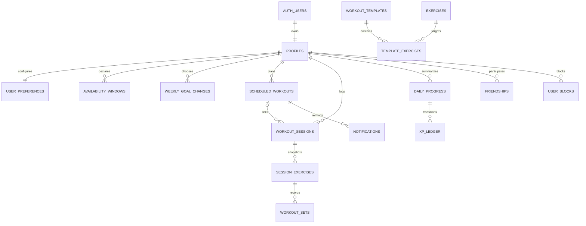

# Database schema specification

Companion to [backend-plan.md](backend-plan.md). This is the migration contract for the implementation agent. It deliberately includes types, nullability, constraints, indexes, and access rules. It is **not executable SQL**; the agent must implement and test migrations and RPCs before deployment.

## 1. Conventions

- Application tables live in `public`; internal rate counters/helpers live in an unexposed `private` schema. Supabase manages `auth.users`.
- `uuid` primary keys default to `gen_random_uuid()` unless they are an Auth user ID or a specified composite key.
- Fields are **NOT NULL unless marked `?`**. `created_at` defaults to `now()`; `updated_at` defaults to `now()` and is maintained by a server trigger. Other defaults are stated explicitly. Store instants as `timestamptz`.
- `user_id` on a user-owned root table references `profiles.user_id ON DELETE CASCADE`. `profiles.user_id` references `auth.users.id ON DELETE CASCADE`. User-owned descendants cascade from their parent. No browser hard deletion of histories or rewards.
- Normalize handles and slugs to lowercase. Prefer `text` plus CHECK constraints for the small enumerations below. For tag arrays, validate allowed values, cardinality, and uniqueness in RPCs and seed validation.
- Validate IANA timezone names against PostgreSQL timezone data in RPCs. Do not store abbreviations such as `EST` or fixed offsets as a timezone. A `date` used for rewards is always in the user's frozen home timezone.
- Use `numeric` for weight/distance, not binary floating point; store kilograms and meters, display either metric or imperial. Client converts pounds to kilograms with a documented rounding convention (0.001 kg storage precision).
- Use integer revisions for optimistic concurrency; client ownership, revisions after mutation, reward values, and server timestamps cannot be assigned through arbitrary payloads.
- Every exposed table has RLS enabled. Authenticated clients have SELECT only where specified. All writes use narrowly granted RPCs. No access is granted to `anon` for app data.
- All mutation RPCs verify an existing profile with `deletion_requested_at IS NULL`, not merely a non-null `auth.uid()`. Account deletion can therefore disable writes immediately.

## 2. Relationship map



There are **14 P0 application tables**, **2 P0b social tables**, and one small P0b internal rate-limit table. Catalog tables are shared reference data; workout and preference tables are private. The calendar/session relation allows cancelled attempts but at most one non-cancelled/non-voided session per scheduled entry.

## 3. P0 identity and preferences

### `profiles`

| Column | Type / default | Contract |
|---|---|---|
| `user_id` | `uuid`, PK | Auth identity; never a second generated user ID |
| `handle` | `text?` | Unique, lowercase `^[a-z0-9_]{3,24}$`; null until onboarding |
| `display_name` | `text`, default `''` | Up to 60 characters; 1–60 when onboarding completes |
| `avatar_key` | `text`, default `'starter_01'` | Allowlist `starter_01`, `starter_02`, `starter_03`; map to actual UI assets |
| `share_progress_with_friends` | `boolean`, default `false` | Opt-in; checked on every social summary request |
| `deletion_requested_at` | `timestamptz?` | Only account-deletion service may set/reset |
| `created_at`, `updated_at` | `timestamptz` | Server maintained |

Index: unique handle index, allowing multiple nulls. Do not duplicate email/password or add client-editable XP, roles, school-verification, or subscription fields. A nullable handle keeps the Auth signup trigger independent of user-selected uniqueness.

### `user_preferences`

| Column | Type / default | Contract |
|---|---|---|
| `user_id` | `uuid`, PK/FK | One row per profile |
| `goals` | `text[]`, default empty array | Proposed codes: `strength`, `muscle_gain`, `endurance`, `general_fitness`; 1–4 unique values when onboarded |
| `experience_level` | `text?` | `beginner`, `intermediate`, `advanced`; required when onboarded |
| `home_timezone` | `text?` | Valid IANA zone; required and frozen once onboarded |
| `preferred_duration_minutes` | `smallint`, default `45` | CHECK 15–180 |
| `unit_system` | `text`, default `'metric'` | `metric` or `imperial` |
| `onboarded_at` | `timestamptz?` | Server sets after validated onboarding |
| `created_at`, `updated_at` | `timestamptz` | Server maintained |

Weekly frequency is stored in `weekly_goal_changes`, not duplicated here. General preference changes do not rewrite past targets or timezones.

### `availability_windows`

| Column | Type / default | Contract |
|---|---|---|
| `id` | `uuid`, PK | Window identity |
| `user_id` | `uuid`, FK | Owner |
| `iso_weekday` | `smallint` | CHECK 1–7, Monday = 1 |
| `starts_local`, `ends_local` | `time without time zone` | CHECK start < end; no overnight windows |
| `created_at` | `timestamptz` | Server maintained |

Unique `(user_id, iso_weekday, starts_local, ends_local)`; index `(user_id, iso_weekday)`. RPC rejects overlapping windows on the same weekday, limits to 14 windows total, and requires at least one window during onboarding. Interpret windows in `home_timezone`, never the database server's timezone. Update by validated atomic replacement.

### `weekly_goal_changes`

| Column | Type / default | Contract |
|---|---|---|
| `user_id` | `uuid`, FK | Owner |
| `effective_week` | `date` | Monday in the home timezone; CHECK `extract(isodow from effective_week) = 1` |
| `target_days` | `smallint` | CHECK 1–7 |
| `created_at`, `updated_at` | `timestamptz` | Server maintained |

Composite PK `(user_id, effective_week)`. Onboarding inserts the current week. Later changes may upsert only the next week; past/current rows are immutable to normal users. Carry the latest effective target forward until superseded. The PK supports reverse lookup for a historical week's applicable goal.

## 4. P0 shared workout catalog

### `exercises`

| Column | Type / default | Contract |
|---|---|---|
| `id` | `uuid`, PK | Stable seeded ID |
| `slug` | `text`, unique | Stable machine key |
| `name` | `text` | 1–100 characters |
| `category` | `text` | `strength`, `cardio`, `mobility` |
| `tracking_mode` | `text` | `reps_weight`, `duration`, `distance_duration` |
| `muscle_groups`, `equipment` | `text[]`, default empty | Curated tags, not arbitrary user input |
| `description` | `text?` | Short basic description, at most 2,000 characters |
| `image_asset_key` | `text?` | Optional existing/licensed app asset, not an arbitrary fetched URL |
| `is_active` | `boolean`, default `true` | Archive instead of deleting |
| `created_at`, `updated_at` | `timestamptz` | Server maintained |

Index `(is_active, category, name)`. Authenticated users can read catalog rows including archived rows needed to explain history; selection screens filter active records. Only deployment seeds/admin tools may write. Changes to tracking mode never alter session snapshots.

### `workout_templates`

| Column | Type / default | Contract |
|---|---|---|
| `id` | `uuid`, PK | Stable seeded ID |
| `slug` | `text`, unique | Stable machine key |
| `title` | `text` | 1–100 characters |
| `description` | `text?` | At most 2,000 characters |
| `goal_tags` | `text[]` | At least one supported goal |
| `experience_levels` | `text[]` | At least one supported experience level |
| `estimated_duration_minutes` | `smallint` | CHECK 15–180 |
| `is_active` | `boolean`, default `true` | Archive instead of deleting |
| `created_at`, `updated_at` | `timestamptz` | Server maintained |

Index `(is_active, title)`. Do not build indexes for every tag combination until catalog size justifies it. A small seeded catalog can be filtered in memory after authenticated fetch.

### `template_exercises`

| Column | Type / default | Contract |
|---|---|---|
| `id` | `uuid`, PK | Template item identity |
| `template_id` | `uuid`, FK | `workout_templates.id`; restrict deletion of live catalog data |
| `exercise_id` | `uuid`, FK | `exercises.id`; restrict deletion |
| `position` | `smallint` | CHECK >= 0; unique within template |
| `target_sets` | `smallint` | CHECK 1–20 |
| `target_reps` | `smallint?` | Positive if supplied |
| `target_duration_seconds` | `integer?` | Positive if supplied |
| `target_distance_meters` | `numeric(10,2)?` | Positive if supplied |
| `rest_seconds` | `integer?` | CHECK 0–600 if supplied |

Unique `(template_id, position)`; index `exercise_id`. Seed validation enforces compatible targets for the exercise mode, 1–30 items per active template, no inactive exercises in active templates, and valid tag values. Repeated use of the same exercise at different positions is allowed.

## 5. P0 scheduling and actual workout data

### `scheduled_workouts`

| Column | Type / default | Contract |
|---|---|---|
| `id` | `uuid`, PK | Scheduled occurrence identity |
| `user_id` | `uuid`, FK | Owner |
| `client_request_id` | `uuid` | Client-generated idempotency key for create |
| `request_fingerprint` | `text` | Server hash of normalized original create input; exactly 64 hex characters |
| `template_id` | `uuid?`, FK | Optional catalog template; archive catalog instead of deleting |
| `title` | `text` | 1–100 characters, snapshotted when created |
| `starts_at`, `ends_at` | `timestamptz` | CHECK end > start; duration 5–240 minutes |
| `timezone` | `text` | Valid IANA display timezone for this occurrence |
| `status` | `text`, default `'planned'` | `planned`, `completed`, `cancelled` |
| `version` | `integer`, default `1` | CHECK >= 1; increment for changed schedule state/content |
| `created_at`, `updated_at` | `timestamptz` | Server maintained |

Unique `(user_id, client_request_id)` and `(id, user_id)`. Index `(user_id, starts_at, id)`. Worker index `(starts_at, id) WHERE status = 'planned'`.

Booking RPCs lock the profile before checking overlapping planned entries. This is safe because direct client writes are revoked; admin/import tools must use equivalent locking/validation. Only completion RPCs can set `completed`. A linked active session prevents cancel/reschedule until the user cancels that active session, avoiding ambiguous reminder and completion state. Status transitions: planned -> cancelled; planned -> completed via session completion; completed -> cancelled via session void. Cancelled occurrences are terminal; create a new occurrence to rebook.

### `workout_sessions`

| Column | Type / default | Contract |
|---|---|---|
| `id` | `uuid`, PK | Actual workout identity |
| `user_id` | `uuid`, FK | Owner |
| `client_request_id` | `uuid` | Retry identity for start |
| `request_fingerprint` | `text` | Server hash of normalized original start input |
| `template_id` | `uuid?`, FK | Original template, if any |
| `scheduled_workout_id` | `uuid?` | Optional calendar occurrence; composite FK described below |
| `title` | `text` | 1–100 characters; snapshot, editable while active |
| `status` | `text`, default `'in_progress'` | `in_progress`, `completed`, `cancelled`, `voided` |
| `started_at` | `timestamptz` | Server assigned when started |
| `completed_at` | `timestamptz?` | Server assigned by completion, retained on void |
| `reward_timezone` | `text` | Snapshot of home timezone when started |
| `local_completion_date` | `date?` | Derived on completion; retained on void |
| `voided_at` | `timestamptz?` | Set only by void RPC |
| `notes` | `text?` | Private, maximum 2,000 characters |
| `revision` | `integer`, default `1` | CHECK >= 1; increment each mutation |
| `created_at`, `updated_at` | `timestamptz` | Server maintained |

Constraints/indexes:

- Unique `(id, user_id)` and `(user_id, client_request_id)`.
- Composite FK `(scheduled_workout_id, user_id)` -> `scheduled_workouts(id, user_id)` prevents linking another user's calendar entry. Use `NO ACTION DEFERRABLE INITIALLY DEFERRED` for this cross-reference; both roots cascade from the account during account deletion.
- Partial unique `(user_id) WHERE status = 'in_progress'`.
- Partial unique `(scheduled_workout_id) WHERE scheduled_workout_id IS NOT NULL AND status IN ('in_progress','completed')`.
- CHECK completed/voided statuses require both completion fields and `completed_at >= started_at`; other statuses require null completion fields. `voided_at` is present exactly for `voided` status.
- History index `(user_id, completed_at DESC, id DESC) WHERE status = 'completed'`.
- Daily reconciliation index `(user_id, local_completion_date) WHERE status = 'completed'`.
- Index `scheduled_workout_id` for foreign-key checks and schedule locking.

All completed sessions satisfy the qualifying-set rule, so no client-editable `is_verified` or `qualifies_for_xp` flag is needed. Voided rows remain private records for reconciliation until account deletion, but ordinary history excludes them. Do not accept backdated client completion timestamps in P0.

### `session_exercises`

| Column | Type / default | Contract |
|---|---|---|
| `id` | `uuid`, PK | Stable exercise-instance ID within the draft |
| `session_id` | `uuid` | Parent |
| `user_id` | `uuid` | Denormalized owner, constrained to parent |
| `exercise_id` | `uuid`, FK | Catalog identity; archived catalog entries retained |
| `position` | `smallint` | CHECK >= 0 |
| `name_snapshot` | `text` | Server copies catalog name |
| `tracking_mode_snapshot` | `text` | Server copies catalog mode |
| `target_sets` | `smallint?` | 1–20 when present |
| `target_reps` | `smallint?` | Positive when present |
| `target_duration_seconds` | `integer?` | Positive when present |
| `target_distance_meters` | `numeric(10,2)?` | Positive when present |
| `rest_seconds` | `integer?` | 0–600 when present |
| `notes` | `text?` | Private, max 1,000 characters |

Composite FK `(session_id, user_id)` -> `workout_sessions(id, user_id) ON DELETE CASCADE`. Unique `(session_id, position)` and `(id, session_id, user_id)`; index `(user_id, session_id)`, plus `exercise_id`. Keep names/modes/targets unchanged for existing child IDs during draft saves; new exercises receive server-created snapshots. Max 30 per session via mutation validation.

### `workout_sets`

| Column | Type / default | Contract |
|---|---|---|
| `id` | `uuid`, PK | Stable set ID during a draft |
| `session_exercise_id`, `session_id`, `user_id` | `uuid` | Constrained lineage and ownership |
| `set_number` | `smallint` | CHECK 1–20 |
| `reps` | `smallint?` | CHECK 1–1,000 if supplied |
| `weight_kg` | `numeric(8,3)?` | CHECK 0–2,000 if supplied; bodyweight work uses zero external load |
| `duration_seconds` | `integer?` | CHECK 1–86,400 if supplied |
| `distance_meters` | `numeric(10,2)?` | CHECK > 0 and <= 1,000,000 if supplied |
| `is_completed` | `boolean`, default `false` | Explicit performed-set marker |

Composite FK `(session_exercise_id, session_id, user_id)` -> `session_exercises(id, session_id, user_id) ON DELETE CASCADE`. Unique `(session_exercise_id, set_number)`. Index `(user_id, session_id)`.

Completed-set validation uses the **snapshotted** mode:

| Mode | Required | Must be null |
|---|---|---|
| `reps_weight` | Positive reps, nonnegative weight (zero allowed) | Duration, distance |
| `duration` | Positive duration | Reps, weight, distance |
| `distance_duration` | Positive duration and distance | Reps, weight |

Uncompleted rows may have missing values but cannot contain fields incompatible with their mode. These bounds are data validation, not advice about appropriate training amounts. Enforce the cross-table mode rule in the write/complete functions or a constraint trigger, not a CHECK with a subquery. All writes lock/verify the active parent. Completed/voided/cancelled session children cannot be changed by ordinary callers.

## 6. P0 progression and reminders

### `daily_progress`

| Column | Type / default | Contract |
|---|---|---|
| `user_id` | `uuid`, FK | Owner |
| `local_date` | `date` | Completion date in frozen home timezone |
| `qualifying_workout_count` | `integer`, default `0` | CHECK >= 0; projection of completed sessions for this date |
| `reward_revision` | `integer`, default `0` | CHECK >= 0; increment only on zero/positive boundary changes |
| `created_at`, `updated_at` | `timestamptz` | Server maintained |

Composite PK `(user_id, local_date)`. Keep rows even when count returns to zero so reward revision numbers are never reused. A day is active iff count > 0. Rows and counters are writable only by completion/void/reconciliation administration, never by the browser. A real mutation recomputes the count from sessions under the user's profile lock rather than trusting an incoming increment.

### `xp_ledger`

| Column | Type / default | Contract |
|---|---|---|
| `id` | `uuid`, PK | Event identity |
| `user_id` | `uuid` | Owner, constrained to daily progress |
| `local_date` | `date` | Reward date |
| `reward_revision` | `integer` | CHECK > 0 |
| `event_kind` | `text` | `day_activated`, `day_deactivated` |
| `delta_xp` | `integer` | +100 for activation, -100 for deactivation |
| `trigger_session_id` | `uuid` | Session whose completion/void caused the transition |
| `rules_version` | `smallint`, default `1` | CHECK = 1 for P0; future changes need explicit policy/migration |
| `created_at` | `timestamptz` | Server event time, not client workout time |

Composite FK `(user_id, local_date)` -> `daily_progress(user_id, local_date) ON DELETE CASCADE`. Composite FK `(trigger_session_id, user_id)` -> `workout_sessions(id, user_id)`, `NO ACTION DEFERRABLE INITIALLY DEFERRED`. Unique `(user_id, local_date, reward_revision)`. Index `(user_id, created_at, id)` and `trigger_session_id`.

CHECK the kind/delta pairing. Revisions alternate activation/deactivation from revision 1; enforce in the transition routine (and optionally a parity CHECK for version 1). Append only during normal operation; account deletion may cascade. Never apply normal corrections by editing a prior event.

Required invariant for every date:

```text
daily_progress.qualifying_workout_count
  = COUNT(workout_sessions WHERE same user/date AND status = 'completed')

SUM(xp_ledger.delta_xp for same user/date)
  = CASE WHEN daily_progress.qualifying_workout_count > 0 THEN 100 ELSE 0 END

daily_progress.reward_revision
  = COALESCE(MAX(xp_ledger.reward_revision for same user/date), 0)
```

Total XP is `COALESCE(SUM(delta_xp),0)` for the user; level and streaks are derived. Do not add a separately mutable level/XP/streak table in P0. `get_my_progress` should aggregate bounded per-user data with existing indexes; add a rebuildable cache only after measurements show a need.

### `notifications`

| Column | Type / default | Contract |
|---|---|---|
| `id` | `uuid`, PK | Notification identity |
| `user_id` | `uuid` | Owner |
| `scheduled_workout_id` | `uuid` | Required for P0 workout reminders |
| `schedule_version` | `integer` | Version this notification describes |
| `kind` | `text`, default `'workout_reminder'` | Only this kind in P0 |
| `due_at` | `timestamptz` | Schedule start minus 30 minutes |
| `read_at` | `timestamptz?` | Set through owner-checked RPC |
| `invalidated_at` | `timestamptz?` | Set by schedule state/version changes |
| `created_at` | `timestamptz` | Server maintained |

Composite FK `(scheduled_workout_id, user_id)` -> `scheduled_workouts(id, user_id) ON DELETE CASCADE`. Unique `(user_id, scheduled_workout_id, schedule_version, kind)`. Index `(user_id, due_at DESC) WHERE read_at IS NULL AND invalidated_at IS NULL`.

No arbitrary HTML/content payload is needed; render a fixed template from the associated schedule. The read query excludes invalidated notifications, stale versions, non-planned schedules, and schedules already started. The worker inserts with a uniqueness conflict ignored; it is not callable by authenticated browser users. Retain notifications for 30 days then purge through a scheduled internal job.

## 7. P0b social tables

Do not create or expose these until implementing the social milestone.

### `friendships`

| Column | Type / default | Contract |
|---|---|---|
| `id` | `uuid`, PK | Relationship identity |
| `user_low`, `user_high` | `uuid`, FKs | Both reference profiles with cascade deletion; CHECK low < high |
| `requested_by` | `uuid` | CHECK equals one of the pair |
| `status` | `text`, default `'pending'` | `pending`, `accepted` |
| `accepted_at` | `timestamptz?` | Present iff accepted |
| `created_at`, `updated_at` | `timestamptz` | Server maintained |

Unique `(user_low, user_high)` prevents duplicate and reciprocal relationship rows. Index `(user_low, status)` and `(user_high, status)`. Decline/cancel/remove deletes the row through its authorized RPC; no durable rejected-request history needed for the beta. Rate limits still apply after deletion. Repeated same-direction requests return the existing relationship; an opposite pending request requires explicit acceptance and must not auto-accept.

All social transitions lock both profiles in ascending UUID order, check deletion state, then check blocks and lock the relationship. This serializes accept-vs-block and reciprocal-request races. Do not allow writes to the pair/requester on an existing relationship.

### `user_blocks`

| Column | Type / default | Contract |
|---|---|---|
| `blocker_id`, `blocked_id` | `uuid`, FKs | Both reference profiles with cascade deletion; CHECK distinct |
| `created_at` | `timestamptz` | Server maintained |

Composite PK `(blocker_id, blocked_id)`; reverse index `(blocked_id, blocker_id)`. Only blocker can list or remove their block. Shared RPCs check existence in either direction. Creating a block and deleting any relationship occur in one transaction. A blocked user should receive the same unavailable response as a non-discoverable user, not the blocker's private block row.

### `private.rate_limit_buckets`

Columns: `user_id uuid` FK profiles cascade, `action text`, `window_start timestamptz`, `request_count integer CHECK > 0`, `expires_at timestamptz`. Composite PK `(user_id, action, window_start)`; index `expires_at`. Actions initially `handle_lookup` and `friend_request`. Revoke schema/table access from anon/authenticated; only a private limiter helper invoked by the authorized social functions may mutate it. Use database-clock UTC minute/day windows and atomic upserts; fixed-window edge bursts are acceptable for this small beta. Expired buckets are deleted daily. Do not record searched handles or private workout content here.

## 8. Permissions matrix

Explicitly revoke direct INSERT/UPDATE/DELETE on application tables from `anon` and `authenticated`, as well as broad default grants. Enable RLS before granting SELECT. For owner tables use `(select auth.uid()) = user_id`; indexed ownership columns keep this straightforward. Apply child ownership through the constrained `user_id`, not an unverified payload field.

| Table | Anonymous | Authenticated direct SELECT | Client mutation path |
|---|---|---|---|
| `profiles` | None | Own row only | `save_onboarding`, `update_profile`; deletion marker service-only |
| `user_preferences` | None | Own row | Onboarding/preferences RPCs |
| `availability_windows` | None | Own rows | Onboarding/preferences RPCs |
| `weekly_goal_changes` | None | Own rows | Onboarding/preferences RPCs, effective-week restrictions |
| Catalog three tables | None | All catalog rows | None; seeds/admin only |
| `scheduled_workouts` | None | Own rows | Schedule RPCs, completion/void |
| `workout_sessions` | None | Own rows | Workout RPCs |
| `session_exercises`, `workout_sets` | None | Own rows | Draft/start RPCs only |
| `daily_progress`, `xp_ledger` | None | Own rows | No direct client mutation; internal completion/void transition |
| `notifications` | None | Own rows | `mark_notification_read` only; internal reminder/schedule functions otherwise |
| `friendships` | None | Participant, and no block in either direction | Social RPCs |
| `user_blocks` | None | Blocker-owned rows only | Block/unblock RPCs |
| Private rate counters | None | None | Internal limiter only |

Direct read policies also require an active (not deleting) profile. Implement this with a narrow internal helper that derives `auth.uid()` itself, avoids recursive `profiles` RLS evaluation, and returns only a boolean. Revoke execution broadly, then grant only the policy callers the minimum helper access. Helpers that check pair blocks for friendship policies must not disclose other users' arbitrary relationships; validate caller participation. Keep the private schema out of the Data API's exposed schemas.

All public RPCs: revoke default `EXECUTE` from `PUBLIC`/`anon`, then grant exact signatures to `authenticated` where needed. Private internal/worker functions get no browser execute grants. Definer functions set `search_path = ''`, fully qualify object names, validate identity and ownership explicitly, avoid dynamic SQL, and return only contract-approved columns. Audit default function privileges in each migration.

RLS alone does not constrain a definer/service-role function. The implementation must test these functions with user A, user B, unauthenticated requests, arbitrary resource IDs, and malicious fields. An owner SELECT policy does not authorize a general UPDATE policy; do not add one as a shortcut for UI integration.

## 9. Migration and seed order

1. Create internal schema, identity/preferences tables, signup bootstrap, and basic active-user helper. Test Auth bootstrap and deletion cascades.
2. Create shared catalog and insert stable, idempotent seed records (approximately 20 exercises and 6 templates is enough to exercise the UI). Seed licensing-safe copy/assets and explicitly identify demonstration content.
3. Create schedule/session/child tables and indexes, then safe RPCs.
4. Create daily progress, XP ledger, notifications, transition/read functions, and internal reminder jobs.
5. Apply and test all P0 grants/RLS as part of the same deployable migration series. Never deploy an intermediate publicly writable schema.
6. Add P0b tables, private limiter, social policies/functions only after P0 acceptance.

Use migrations for schema and deterministic catalog additions. Use local test fixtures for Auth users, friendships, and workout histories; never seed test accounts into production. The seed should be rerunnable without duplicate templates/exercises. Regenerate TypeScript types after migration changes. Document any migration from Figma-generated key-value data separately; this specification assumes no existing production records until repository inspection proves otherwise.

## 10. Required integrity checks

The acceptance suite must cover composite ownership FKs, one active session, unique schedule/session retry IDs, unique daily transition revisions, catalog snapshot preservation, immutable completed children, unauthorized social transitions, no public function execution leaks, and account deletion through the full cascade graph. In particular, verify account deletion with a scheduled/completed/voided session and multiple ledger transitions; the deferred cross-references must not obstruct deletion.

For the weekly progress function, test historical target changes, Monday/year boundaries, empty weeks, current-week grace behavior, and removal of a past qualifying date. Enumerate all weeks from onboarding to the current week, including zero-activity weeks, so missing rows cannot incorrectly join streaks across a gap.
